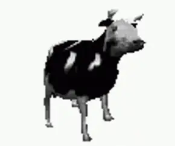

  &nbsp;&nbsp;&nbsp;

 

<picture>
  <source media="(prefers-color-scheme: dark)" srcset="https://raw.githubusercontent.com/rafifnurfariz/rafifnurfariz/output/pacman-contribution-graph-dark.svg?v=2" />
  <source media="(prefers-color-scheme: light)" srcset="https://raw.githubusercontent.com/rafifnurfariz/rafifnurfariz/output/pacman-contribution-graph-light.svg?v=2" />
  
</picture>

  

  
  &nbsp;
  

 

  

